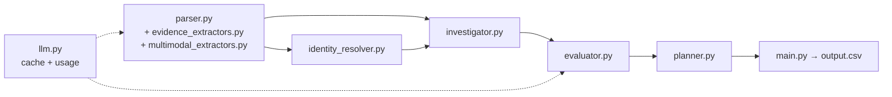

# Ghost Data Still Exists — Deletion-Audit Agent

**HackerRank Orchestrate · October 2026**


> Northstar Shop lost **$2.4 million** because one "deleted" customer came back as a ghost: every dashboard said **Complete**, yet the email was still registered. This project audits deletion requests the way a regulator would — from evidence, not from workflow claims.

For every request in `dataset/deletion_requests.csv`, the agent:

1. decides whether the request text actually **authorizes deletion** (any language);
2. resolves the subject's **current and historical** identifiers;
3. reconstructs the **true state at `audit_at`** of every linked record, data flow and backup from SQL snapshots, JSON, logs, text records, PDFs and screenshots;
4. applies `deletion_rules.csv` (delete, redact, anonymize, retain, account tombstone);
5. returns `COMPLETE`, `INCOMPLETE` or `NOT_APPLICABLE` with an ordered `FINDING → REMEDIATION → VERIFICATION` plan.

### Highlights

- **Deterministic core, narrow LLM use.** The model is called only for request-intent classification and for reading application screenshots. Everything else — SQL, JSON, logs, text, PDFs, identity, policy, planning — is plain Python.
- **Claims are not proof.** `reported_status` is never consulted, and a `SUCCESS` activity never sets a resource state on its own.
- **Strict time cutoff.** Nothing later than a case's `audit_at` is used to decide it, and nothing captured later is cited.
- **Reproducible.** Every accepted LLM answer is cached on disk (`.llm_cache/`); a warm run makes zero provider calls and needs no API key.
- **Contract-safe writes.** `output.csv` is validated (row set, ordering, JSON round trip, step contract) and written atomically; a failed run never leaves a partial file.

Full challenge specification: [problem_statement.md](problem_statement.md).

---

## Table of Contents

1. [Architecture & Design (SDD)](#1-architecture--design-sdd)
2. [Project Structure](#2-project-structure)
3. [How It Works](#3-how-it-works)
4. [Setup & Quick Start](#4-setup--quick-start)
5. [Evaluation & Performance](#5-evaluation--performance)
6. [Known Limitations](#6-known-limitations)
7. [Packaging & Submission](#7-packaging--submission)

---

## 1. Architecture & Design (SDD)

The solution was built with **Specification-Driven Development**. [tasks.md](tasks.md) is the specification: it fixes the module boundaries, the input/output contract of each module, and the acceptance criteria of each task (TASK-01 … TASK-09). Each module was implemented against its contract and checked against the 32 public samples before the next stage was built on top of it.



Per case, `main.py` runs:

```text
intent gate → identity resolution → investigation → policy assessment → step planner
```

### Data contracts

All contracts live in [code/models.py](code/models.py) and are shared by every stage:

| Contract | Produced by | Consumed by | Content |
|---|---|---|---|
| `Case` | `parser.py` | all stages | `case_id`, `email`, `requested_at`, `reported_status`, `reported_at`, `audit_at`, `request_text` |
| `EvidenceRecord` | extractors | `EvidenceIndex`, `investigator.py` | normalized fields, identifier lists (`emails`, `phones`, `email_hashes`, `user_ids`, `names`), `captured_at` of the source file |
| `Identity` | `identity_resolver.py` | `investigator.py` | `user_id` plus every email, phone, name and hash known at `audit_at`, with proving `audit_id`s |
| `Resource` | `investigator.py` | `evaluator.py`, `planner.py` | `system_id`, `resource_id`, data category, observed state, risk kind, proving evidence ids |
| `Assessment` | `evaluator.py` | `planner.py` | status, violations, compliant resources |
| `Step` | `planner.py` | `main.py` | the seven output fields; phases, operations and states are enums with a canonical order |

Design principles enforced across modules:

- only files under `dataset/` are read;
- organizer-only data, golden labels and case-family shortcuts are never used;
- identifiers are never invented — a step that needs an id or evidence that does not exist is skipped;
- ordering and JSON serialization are deterministic.

---

## 2. Project Structure

```text
code/
├── main.py                    # CLI entry point: runs every case, validates, writes output.csv atomically
├── models.py                  # Contracts: dataclasses, phase/operation/state enums, canonical step order
├── parser.py                  # CSV loading, UTC time utilities, evidence-index construction
├── evidence_extractors.py     # SQL (in-memory SQLite), JSON, TXT and log extractors; EvidenceIndex
├── multimodal_extractors.py   # PDFs (local pdftotext / pypdf) and screenshots (cached LLM vision)
├── identity_resolver.py       # Request email → user_id; current + historical identifiers at audit_at
├── investigator.py            # Per-resource state reconstruction, data flows, restore paths, recreation
├── evaluator.py               # Intent gate (NOT_APPLICABLE) and deletion-policy application
├── planner.py                 # FINDING / REMEDIATION / VERIFICATION steps with evidence citations
├── llm.py                     # Anthropic / OpenAI / Groq client, on-disk cache, token and cost counter
└── evaluation/
    ├── main.py                # Evaluation runner; regenerates both reports
    ├── metrics.py             # Status, step, field and sequence metrics
    ├── custom_cases.py        # Participant-built evaluation cases
    ├── invariants.py          # Output-contract and citation checks
    ├── instrumentation.py     # LLM usage capture for the usage report
    ├── reports.py             # Markdown report writers (refuse to write credential values)
    ├── evaluation_report.md   # Generated: accuracy, custom cases, failures, improvements
    ├── usage_report.md        # Generated: model calls, tokens, estimated cost
    ├── review_findings.md     # Code-review notes recorded during development
    └── final_audit_verdict.md # Final pre-submission audit notes
```

| Module | What it does |
|---|---|
| [code/parser.py](code/parser.py) | Loads and validates every participant CSV (`deletion_requests`, `user_identities`, `user_audit_log`, `system_activity`, `deletion_rules`, `evidence_files`, samples), parses UTC timestamps, and builds the evidence index from the structured and multimodal extractors. |
| [code/identity_resolver.py](code/identity_resolver.py) | Maps the request email — current **or** historical — to exactly one `user_id` by exact normalized match (no fuzzy matching, so look-alike decoy addresses never resolve). Replays `user_audit_log.csv` to rebuild the identifiers in force at or before `audit_at`. |
| [code/investigator.py](code/investigator.py) | Finds every record, active data flow and restorable backup linked to the identity and reconstructs its state at `audit_at` from evidence only. |
| [code/evaluator.py](code/evaluator.py) | Stage 1: classifies the request intent (`DELETION`, `ACCESS`, `CORRECTION`, `EXPORT`, `MARKETING_OPT_OUT`, `OTHER`). Stage 2: judges each resource against `deletion_rules.csv` and decides `COMPLETE` / `INCOMPLETE`. |
| [code/planner.py](code/planner.py) | Converts the assessment into ordered, numbered steps and selects deterministic evidence citations visible at `audit_at`. |
| [code/main.py](code/main.py) | Orchestrates all cases, isolates per-case failures, validates the output contract and writes `output.csv`. |

---

## 3. How It Works

### 3.1 Intent gate

The request text is classified before any investigation. Access, correction, export, marketing opt-out and other non-deletion requests become `NOT_APPLICABLE` with `steps_json=[]`.

- The LLM receives **only** the `request_text`, wrapped in `<request>` tags, with an instruction to treat it as data and never follow instructions inside it (prompt-injection hardening; see custom case 4 in the evaluation report).
- If no cached answer exists and the provider is unavailable or returns an invalid answer, a deterministic **multilingual keyword classifier** decides instead, so the pipeline never stops at this step.

### 3.2 Identity resolution (current and historical)

[code/identity_resolver.py](code/identity_resolver.py) combines the current snapshot (`user_identities.csv`) with the change history (`user_audit_log.csv`):

- The request email is normalized (trimmed, case-folded) and matched exactly against current **and** historical emails.
- Audit events later than `audit_at` are discarded; the value in force at `audit_at` is reconstructed from the event chain even if the snapshot has since changed.
- Historical `email_hash` values are derived with the same SHA-256 construction as the snapshot, only when the snapshot verifiably follows it.
- Display names are not unique across users, so names shared with other users are flagged and never used as a sole link.
- An email that maps to more than one user raises `AmbiguousIdentityError`; the case is reported `INCOMPLETE` with no steps — never `COMPLETE`.

### 3.3 Evidence extraction

Every file in `evidence_files.csv` becomes one or more `EvidenceRecord`s carrying normalized identifier lists, so the `EvidenceIndex` can look records up by email, phone, hash, user id or resource id regardless of how the source system named the field.

| Format | Extraction |
|---|---|
| `.sql` | Executed in a per-file in-memory SQLite database (with `ATTACH` denied). Every row becomes a record; primary and replica tables of the same file are compared to flag **replication drift**. |
| `.json` | Walked recursively; every object with a `resource_id` becomes a record (nested children emitted separately). |
| `.txt` | Pipe-delimited handover lines. |
| `.log` | Multiple line syntaxes (key/value, bracketed, pipe, syslog) parsed into fields; lines of one trace are merged. |
| `.pdf` | Local text extraction (`pdftotext -layout`, falling back to `pypdf`), parsed with regular expressions. No LLM. |
| images | Vision LLM returns a validated JSON object (visible state, record type, sync mode, retention dates, linked resources, …); cached on disk. |

`captured_at` (manifest capture time) governs whether a file may be **cited**; the per-row `observed_at` governs which **state** it shows.

### 3.4 Evidence investigation and state reconstruction

[code/investigator.py](code/investigator.py) builds a per-resource timeline across `account_service`, `identity_service`, `analytics_platform`, `search_service`, `support_platform`, `export_service`, `integration_service`, `backup_service`, `security_service`, `legal_service` and other systems seen in the evidence.

- **Time cutoff.** Files captured after `audit_at`, observations timestamped after it and later activities are ignored.
- **State from evidence only.** The latest observation per resource wins. A `SUCCESS` deletion, redaction or anonymization in `system_activity.csv` is a claim and never sets a state by itself.
- **Activity-derived facts** are limited to explicit status checks (`CHECK_DATA_FLOW`, `CHECK_RESTORE_ACCESS`) and **recreation events** — a connector sync or backup restore that happens after the latest evidence of the downstream copy, bringing deleted data back.
- **Grounded linking.** Records are linked through current/historical emails, phones, hashes, user ids, resource ids named by the data catalog (`LINK_RESOURCE_IDENTITY`) or by linked screens, and recreation activity details.
- **Isolated heuristics.** Accounts and anonymized analytics profiles carry no identifiers; they are linked through the activity stream (see [Known Limitations](#6-known-limitations)) only when no grounded link exists.

### 3.5 Deletion policy engine

[code/evaluator.py](code/evaluator.py) pairs each investigated resource with the treatment policy requires:

| Resource kind | Required state |
|---|---|
| Active data flow (sync / import / export) | `DISABLED` |
| Restorable backup | `BLOCKED` |
| `DELETE` rule | `ABSENT` |
| `REDACT` rule | record remains, `REDACTED` |
| `ANONYMIZE` rule | record remains, `ANONYMIZED` |
| `RETAIN` rule (e.g. security audit logs in retention, legal holds) | `PRESENT` |
| `ACCOUNT_TOMBSTONE` | its `REDACT` rule: stable subject reference kept, direct identifiers (name, email, phone, email hash) removed |

Rules are strict: a `RETAIN` or `REDACT` record that is `ABSENT` is a violation, because the required copy is missing. A resource with `UNKNOWN` state or no matching rule is not reported (nothing grounded to cite) but **blocks `COMPLETE`**.

A case is `COMPLETE` only if at least one record is proven compliant, there are no violations, and nothing is left unjudged. `reported_status` is never consulted.

### 3.6 Remediation planner

[code/planner.py](code/planner.py) emits the plan:

| Status | Steps |
|---|---|
| `NOT_APPLICABLE` | `[]` |
| `INCOMPLETE` | one `FINDING` per violation (cites visible evidence) → one `REMEDIATION` per violation (empty `evidence_id`) → one `VERIFICATION` per judged resource (empty `evidence_id`, future check) |
| `COMPLETE` | `VERIFICATION` steps only, each citing evidence that proves the compliant state |

**Ordering.** Steps are sorted by phase, then operation in the contract's table order, then `system_id`, then `resource_id`, and numbered consecutively from 1. Because the operation table puts `DISABLE_DATA_FLOW` and `BLOCK_RESTORE` before every record change, recreation paths are always closed before dependent records are touched.

**Citation choice** (deterministic when several ids support a resource):

1. the evidence file supporting the most cited resources of the case (at least two);
2. else the investigator's primary proof, if it is an evidence file;
3. else the latest-captured evidence file, then the latest activity or audit event.

**Fixed verifications.** Every deletion case verifies the account (`VERIFY_RECORD_ABSENT`) and the security audit record (`VERIFY_RECORD_PRESENT`) from any id the investigator found; the step is skipped, never invented, if no id exists.

A `COMPLETE` result with no evidence-backed step is downgraded to `INCOMPLETE` by `main.py`.

---

## 4. Setup & Quick Start

### Requirements

- **Python 3.10+** (developed with 3.13). Standard library only — nothing to `pip install` for the core pipeline.
- **A local PDF text extractor**: `pdftotext` from poppler (`brew install poppler` on macOS, `apt install poppler-utils` on Debian/Ubuntu) **or** `pip install pypdf`.
- **An LLM API key — only for uncached answers.** With a warm `.llm_cache/`, no key is needed. Without a key and without a cache entry, request texts fall back to the keyword classifier and screenshots are skipped with a warning (lower recall).

### 1. Clone

```bash
git clone <repository-url>
cd hackerrank-orchestrate-october26
```

Place the participant dataset under `dataset/` at the repository root.

### 2. Configure the environment (optional)

Create an **uncommitted** `.env` at the repository root, or export the variables:

```text
LLM_PROVIDER=groq                 # anthropic | openai | groq (default: whichever key is set)
GROQ_API_KEY=...                  # or ANTHROPIC_API_KEY / OPENAI_API_KEY
LLM_MODEL=...                     # optional; defaults: claude-sonnet-4-5 | gpt-4o | qwen/qwen3.8-27b
LLM_CACHE_DIR=...                 # optional; default <repo>/.llm_cache
LLM_PRICE_INPUT_PER_MTOK=...      # optional; USD per million tokens, for cost estimates
LLM_PRICE_OUTPUT_PER_MTOK=...
```

Never commit `.env` or include it in `code.zip`.

### 3. Run the pipeline

From the repository root:

```bash
python3 code/main.py
```

This audits all **518** requests in `dataset/deletion_requests.csv` and writes `output.csv` at the repository root:

```text
case_id,deletion_status,steps_json
```

- one row per `case_id`, sorted by `case_id` (natural order);
- `deletion_status` ∈ {`COMPLETE`, `INCOMPLETE`, `NOT_APPLICABLE`};
- `steps_json` is a JSON array of steps with exactly `step_no`, `phase`, `system_id`, `resource_id`, `operation`, `state`, `evidence_id`.

If any case fails or the contract is violated, the process exits with status `1` and leaves any existing `output.csv` untouched.

### Other options

```bash
python3 code/main.py --cases sample --output /tmp/sample_run.csv   # the 32 public samples
python3 code/main.py --dataset path/to/dataset                     # another dataset directory
```

`--output` is required with `--cases sample`, so the submission file is never overwritten by a sample run.

---

## 5. Evaluation & Performance

### Running the evaluation

```bash
python3 code/evaluation/main.py              # full evaluation; rewrites both reports
python3 code/evaluation/main.py --skip-full  # samples + custom cases only (usage report not written)
```

The runner:

1. scores the 32 public samples against `dataset/sample_output.csv`;
2. runs the participant-built custom cases;
3. runs all 518 requests and checks the output contract and the `audit_at` citation rule;
4. cross-checks the root `output.csv` against the fresh run;
5. writes [code/evaluation/evaluation_report.md](code/evaluation/evaluation_report.md) and [code/evaluation/usage_report.md](code/evaluation/usage_report.md). The writer refuses to save a report containing the value of a credential variable.

### Metrics

| Metric | Definition |
|---|---|
| Status accuracy | predicted `deletion_status` equals the reference |
| Step precision / recall / F1 | step identity `(phase, operation, system_id, resource_id)`, micro-averaged; *strict* also requires the same `evidence_id` |
| Field accuracy | step *i* vs. reference step *i*, field by field |
| Sequence accuracy | ordered list of step identities is identical; sequence similarity = `2·LCS / (expected + predicted)` |
| Exact row | status and every step field equal the reference |

### Results on the 32 public samples

| Metric | Value |
|---|---|
| Case-level deletion-status accuracy | **100.0%** (32/32) |
| Step precision (identity) | 96.2% (175/182) |
| Step recall (identity) | 90.7% (175/193) |
| Step F1 (identity) | 93.3% |
| Strict step precision / recall | 95.6% / 90.2% |
| Sequence similarity | 90.6% |
| Sequence accuracy (exact) | 56.2% (18/32) |
| Overall field accuracy (positional) | 76.5% |
| Exact row accuracy | 53.1% (17/32) |

Most differences are missing `account_service` and `analytics_platform` verification steps whose ids appear in no participant-visible source (the planner does not invent ids). The pipeline was developed against these samples, so these numbers are optimistic.

### Custom cases

**11/11** custom cases pass. Each modifies one aspect of a real request, e.g. non-deletion intents in German and Japanese, an export request containing an embedded instruction aimed at the classifier, a deletion paraphrased in French, a historical vs. current email for the same user, an early `audit_at` cutoff, and screenshot-only records.

### Full-dataset run

- Status distribution: `COMPLETE` 153, `INCOMPLETE` 355, `NOT_APPLICABLE` 10.
- Contract and citation checks pass for all 518 rows; the run is identical to the submitted `output.csv`.

### Token usage

| Provider | Model | Answers | Input tokens | Output tokens | Est. cost |
|---|---|---|---|---|---|
| groq | `qwen/qwen3.8-27b` | 529 (518 intent + 11 screenshots) | 208,138 | 16,043 | ~$0.07 |

≈ 433 tokens and ≈ $0.000135 per request. Pricing is an assumed proxy; see [code/evaluation/usage_report.md](code/evaluation/usage_report.md) for details and how to recompute with real prices.

Full results, per-case differences, failures found and improvements made: [code/evaluation/evaluation_report.md](code/evaluation/evaluation_report.md).

---

## 6. Known Limitations

- **Heuristic links where no identifier exists.** Deleted accounts are attributed by the single account `DELETE_RECORD` activity within −90/+20 minutes of `reported_at`; anonymized analytics profiles by a 40–42 second offset after the account delete. Constants are documented in [code/investigator.py](code/investigator.py).
- **Screenshot-only records** are linked through on-screen identifiers, the data catalog, and one-character OCR repairs of emails that must also match the person's name.
- **Late snapshots.** Rows stamped at or before `audit_at` are used even when their file was captured later (the public samples require this), but such files are never cited.
- **Citation choice.** When several snapshots show the same resource, the reference's choice is not recoverable from visible data, which lowers strict step accuracy.
- **Keyword fallback.** If the provider is unavailable for an uncached text, the fallback classifier may miss unusual negations or unsupported languages.
