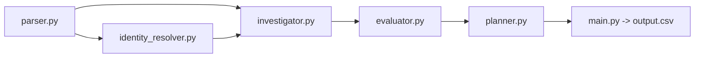

# HackerRank Orchestrate - October 2026

## Ghost Data Still Exists

Build an AI agent that audits whether a user's personal data was actually deleted.

A deletion workflow may report **Complete** while data still exists in databases, logs, support attachments, exports, search indexes, archives, or backups. Sync and restore processes may also bring deleted data back.

For each request, the agent must first determine whether deletion was actually requested. It then returns `COMPLETE`, `INCOMPLETE`, or `NOT_APPLICABLE`, reports any remaining data or recreation risk, and produces the ordered remediation and verification steps required to finish an authorized deletion safely.

Read [`problem_statement.md`](./problem_statement.md) for the complete challenge contract.

---

## Solution

A deterministic Python pipeline that uses an LLM only where code cannot decide: the multilingual meaning of the request text and the contents of application screenshots. Every accepted model answer is cached on disk, so a second run needs no provider call and no API key.



| Module (`code/`) | Responsibility |
| --- | --- |
| `models.py` | Contracts: cases, steps, allowed phases, operations and states, and their canonical order |
| `parser.py`, `evidence_extractors.py`, `multimodal_extractors.py` | Load the CSVs; extract evidence from SQL (executed in in-memory SQLite), JSON, text, logs, PDFs (local text extraction) and images (cached LLM vision) |
| `identity_resolver.py` | Request email (current or historical) to `user_id`, plus every identifier the person had at `audit_at` |
| `investigator.py` | Rebuild the state of every linked record at `audit_at` from evidence only; detect active data flows, restore paths and recreation |
| `evaluator.py` | Intent gate (`NOT_APPLICABLE`), then apply `deletion_rules.csv` to each resource and decide `COMPLETE` / `INCOMPLETE` |
| `planner.py` | Build the ordered `FINDING` / `REMEDIATION` / `VERIFICATION` steps with evidence ids |
| `llm.py` | LLM client (Anthropic, OpenAI or Groq), response cache, token and cost counter |
| `main.py` | Run all cases, validate the output contract, write `output.csv` atomically |
| `evaluation/` | Evaluation runner, custom cases, and the generated reports |

Rules the pipeline follows: only files under `dataset/` are read; nothing later than a case's `audit_at` is used or cited; `reported_status` and activity results are treated as claims, not proof; no labels are hardcoded.

## Setup

Requirements:

- Python 3.10 or newer (developed and run with 3.13). The code uses only the standard library; there is nothing to `pip install`.
- A local PDF text extractor for the evidence PDFs: `pdftotext` from poppler (`brew install poppler` on macOS, `apt install poppler-utils` on Debian/Ubuntu), or `pip install pypdf`.
- An LLM API key, needed only when an answer is not already in the cache (`.llm_cache/`). Without a key, uncached request texts are classified by a built-in multilingual keyword fallback, and uncached screenshots are skipped with a warning (their evidence is then missing, which lowers recall).

Create an uncommitted `.env` file at the repository root (or export the variables). Never commit it.

```text
LLM_PROVIDER=groq                 # anthropic, openai or groq (default: whichever key is set)
GROQ_API_KEY=...                  # or ANTHROPIC_API_KEY / OPENAI_API_KEY
LLM_MODEL=...                     # optional, provider-specific default otherwise
LLM_CACHE_DIR=...                 # optional, default <repo>/.llm_cache
LLM_PRICE_INPUT_PER_MTOK=...      # optional, USD per million tokens, for cost estimates
LLM_PRICE_OUTPUT_PER_MTOK=...
```

## Run

From the repository root:

```bash
python3 code/main.py
```

This audits the 518 requests of `dataset/deletion_requests.csv` and writes `output.csv` (header `case_id,deletion_status,steps_json`, one row per case, sorted by `case_id`). The output is validated before anything is written: if a case fails or the contract is violated, the process exits with status 1 and leaves any existing `output.csv` untouched. With a warm cache a run takes seconds to a few minutes; a cold run makes one short model call per distinct request text plus one per screenshot and is limited by the provider's rate limits.

Useful options:

```bash
python3 code/main.py --cases sample --output /tmp/sample_run.csv   # the 32 public samples
python3 code/main.py --dataset path/to/dataset                     # another dataset directory
```

## Evaluate

```bash
python3 code/evaluation/main.py              # full evaluation, rewrites both reports
python3 code/evaluation/main.py --skip-full  # samples and custom cases only (about as fast as a sample run)
```

The runner scores the 32 public samples against `dataset/sample_output.csv` (status, step, field and sequence accuracy), runs seven custom cases built from those samples, runs all 518 requests to check the output contract and the `audit_at` citation rule, cross-checks the root `output.csv`, and writes:

- [`code/evaluation/evaluation_report.md`](./code/evaluation/evaluation_report.md): accuracy metrics, custom cases, failures found and improvements made;
- [`code/evaluation/usage_report.md`](./code/evaluation/usage_report.md): model calls, tokens and estimated cost of the full-dataset run.

Reports never contain API keys: the writer refuses to save a report that contains the value of a credential variable.

## Contract summary

The blank template at `dataset/output.csv` is a reference; the file to submit is the generated root-level `output.csv`. See [`problem_statement.md`](./problem_statement.md) for the full contract and [`tasks.md`](./tasks.md) for the design notes and known limits of each module.


## Dataset

All participant-facing files are in `dataset/`:

| File | Contents |
| --- | --- |
| `deletion_requests.csv` | 518 requests |
| `sample_deletion_requests.csv` | 32 sample requests |
| `sample_output.csv` | Correct sample answers |
| `user_identities.csv` | Current user identities |
| `user_audit_log.csv` | Historical identity changes |
| `system_activity.csv` | Activity across services and data processes |
| `deletion_rules.csv` | Required treatment for each data category |
| `evidence_files.csv` | Manifest of supplied evidence files |
| `output.csv` | Blank output template |

Evidence is stored under `dataset/evidence/` and may include PDFs, images, logs, JSON, plain text, or SQL snapshot exports. SQL captures may contain a primary database, regional replicas, a reporting replica, or a failover replica so replication drift can be investigated directly. The `.sql` files are readable as text and executable with SQLite.

Only `deletion_requests.csv` requires answers. The other files provide evidence and context.

---

## Output

Create `output.csv` with these columns in this exact order:

```text
case_id,deletion_status,steps_json
```

Produce exactly one row per request. `deletion_status` is `COMPLETE`, `INCOMPLETE`, or `NOT_APPLICABLE`. `steps_json` is an ordered JSON array containing findings, remediation actions, and verification checks. Use an empty array (`[]`) for `NOT_APPLICABLE`. Evidence references may be a `file_id`, `activity_id`, or `audit_id`. Determine the resource state at `audit_at` from the available evidence; reported workflow statuses and operation results are claims. Use `dataset/sample_output.csv` as the format reference.

The final file must contain 518 data rows sorted by `case_id` (plus the header row). The grader parses `steps_json` as JSON, so object-key order and whitespace do not matter; array order does. Order findings, remediation, and verification in that phase order. Within a phase, follow the operation order in the problem statement, then sort by `system_id` and `resource_id`.

---

## Evaluation

`output.csv` will be compared with hidden canonical answers. Scoring considers:

- deletion assessment accuracy;
- current and historical identity resolution;
- discovery of remaining data and recreation risks;
- correct policy application and evidence references; and
- completeness and ordering of remediation and verification steps.

Your `code.zip` must include:

```text
code/evaluation/evaluation_report.md
code/evaluation/usage_report.md
```

- `evaluation_report.md` must cover case, row, field, and sequence accuracy, at least three additional evaluation cases created by you, failures found, and improvements made.
- `usage_report.md` must cover the final full-dataset run, including model providers and names, model calls, input and output tokens, total and average tokens per request, and estimated total and per-request cost. Include per-model and overall totals when using multiple models.

**Important:** Place `evaluation_report.md` and `usage_report.md` inside `code/evaluation/` (matching `code/evaluation/main.py` in this starter layout), write your complete evaluation metrics, custom evaluation test cases, and token/cost breakdowns directly inside those Markdown files, and keep prompts in source code or Markdown files. Automated code evaluation ignores raw data files (`.csv`, `.tsv`, `.json`, `.jsonl`, `.sql`, `.log`), so content stored only in those formats will not be visible to the code judge or AI interviewer.

---

## Chat Transcript

This repository includes [`AGENTS.md`](./AGENTS.md), which instructs compatible AI coding tools to append conversation summaries to `log.txt` in the repository root:

| Platform | Path |
| --- | --- |
| macOS / Linux | `<repo root>/log.txt` |
| Windows | `<repo root>\log.txt` |

- Always launch your AI coding agent from the repository root (or explicitly ask it to read `./AGENTS.md` first) so every turn is logged to `log.txt` with the required `User Prompt`, `Agent Response Summary`, `Actions`, and `Context` sections.
- Upload `log.txt` directly as your `chat_transcript` submission on HackerRank.
- Do not include API keys, tokens, credentials, or secrets in prompts, code, configuration, or `log.txt`.

---

## Known Limitations

- **Heuristic links** (no identifier exists in the data): the second-of-minute fingerprint used to attribute anonymized analytics profiles, the `reported_at` window used to attribute a deleted account, and a last-resort lone analytics anonymization near `reported_at`. They only run when no grounded link exists (constants are documented in `code/investigator.py`).
- **Screenshot-only records** are linked through identifiers shown on screen, the data catalog (`LINK_RESOURCE_IDENTITY`, including the file name in parentheses) and one-character OCR repairs of emails that must also match the person's name. A catalog link wins over a different name shown on screen.
- **Late snapshots**: rows stamped at or before `audit_at` are used even when their file was captured later (the public samples require this), but such files are never cited.
- **Ambiguous emails** that cannot be resolved to one user (even by who held the address at `requested_at`) yield `INCOMPLETE` with `[]`, never `COMPLETE`.
- **Packaging**: build `code.zip` with the command below from the repository root. `.env` (live API key) and `.llm_cache/` live outside `code/` and must stay out of the archive; rotate any key that was ever stored in `.env`.

---

## Packaging `code.zip` and Submission

| Item | Description |
| --- | --- |
| `code.zip` | Runnable solution, prompts, configuration, `README.md`, and `evaluation/` reports |
| `output.csv` | One answer row for each of the 518 requests in `dataset/deletion_requests.csv` |
| `chat_transcript` | The root `log.txt` file generated by your coding agent |
| AI interview | Live explanation of your architecture, approach, and evaluation |

You may use any programming language, model, framework, or retrieval approach. Include clear setup and execution instructions in `README.md` inside `code.zip`.

To package `code.zip` from the repository root without bundling the dataset:

**macOS / Linux:**

```bash
zip -r code.zip README.md code -x "*/__pycache__/*" "*/.venv/*" "*/venv/*" "*/node_modules/*" "*/.git/*" "*/.DS_Store"
```

**Windows (PowerShell):**

```powershell
Compress-Archive -Path README.md, code -DestinationPath code.zip -Force
```

When packaging `code.zip`:

- Keep your evaluation reports in `code/evaluation/` so they are bundled automatically with `code` (or add `evaluation` to the archive command above if you placed them in a top-level `evaluation/` directory).
- Do **not** include `dataset/`, virtual environments (`.venv`, `venv`, `node_modules`), or build caches (`__pycache__`). On Windows, keep `.venv` at the repository root (outside `code/`) and remove any `code/__pycache__` folders before running `Compress-Archive`.
- Do **not** include nested archives (`.zip`, `.tar`, `.gz`, `.tgz`, `.7z`, `.rar`) inside `code.zip` — submissions containing nested archive files will be rejected.

Before submitting, confirm that:

- `output.csv` has the exact header `case_id,deletion_status,steps_json` and contains all 518 data rows sorted by `case_id`;
- every `steps_json` value is a valid JSON array with consecutive step numbers starting at `1`;
- findings cite valid evidence IDs, and `COMPLETE` verification steps cite evidence proving the current state;
- proposed remediation and future verification steps use an empty `evidence_id` (`""`);
- `code.zip` includes your runnable code, `README.md`, `code/evaluation/evaluation_report.md`, and `code/evaluation/usage_report.md`;
- `log.txt` follows the `AGENTS.md` turn format and is uploaded to the `chat_transcript` slot; and
- no API keys, credentials, real personal data, or sensitive configuration values are included.
