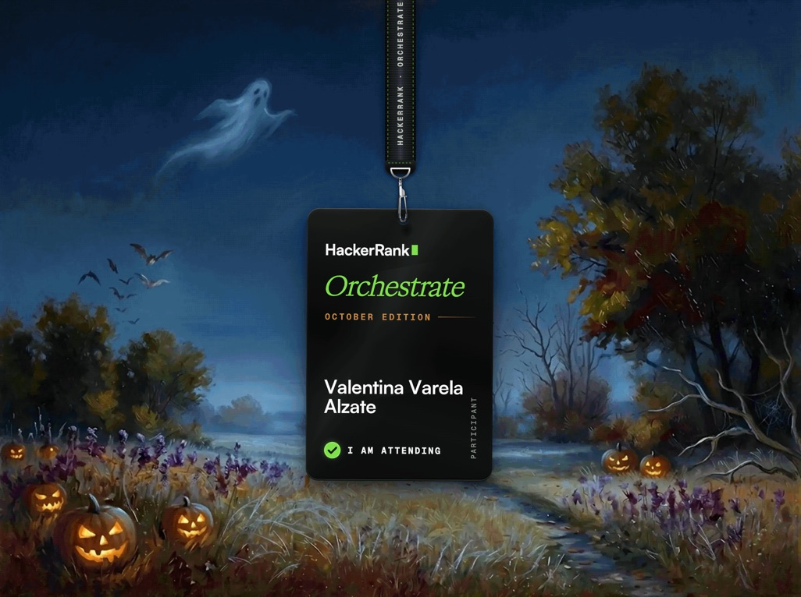
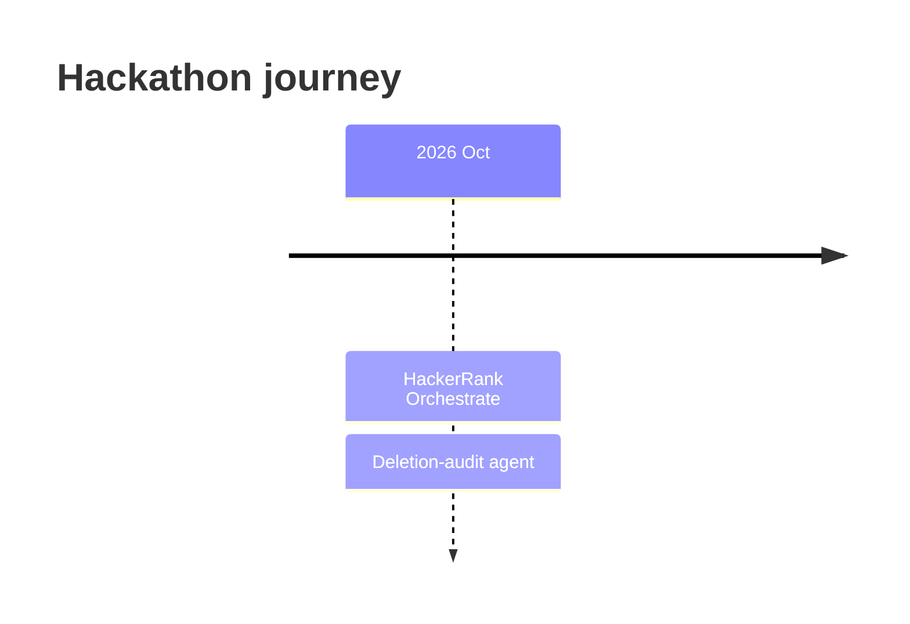
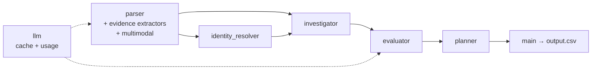

# Hackathons

[](#-participations)
[](#-trophy-case)
[](#hackerrank-orchestrate--october-2026)
[](hackerrank-orchestrate-october26)
[](hackerrank-orchestrate-october26/tasks.md)

A collection of every hackathon I take part in: the challenge, my solution, and how it went. Each project lives in its own folder with its full commit history.

[](#hackerrank-orchestrate--october-2026)

## 🏆 Trophy case

| 🥇 Wins | 🥈 Podiums | 🎟️ Participations | 📦 Projects shipped |
| :---: | :---: | :---: | :---: |
| **0** | **0** | **1** | **1** |

> This section updates as results come in. Wins and podiums will show up here with their medals.

## 🎟️ Participations

| Date | Hackathon | Project | Stack | Result |
| --- | --- | --- | --- | --- |
| Oct 2026 | [HackerRank Orchestrate, October Edition](#hackerrank-orchestrate--october-2026) | [Ghost Data Still Exists, deletion-audit agent](hackerrank-orchestrate-october26) |    |  Results pending |

## 🗺️ Timeline



---

## HackerRank Orchestrate · October 2026


**Challenge: _Ghost Data Still Exists._** Northstar Shop, an imaginary company, lost **$2.4 million** after one supposedly deleted customer came back as a ghost: every dashboard said **Complete**, yet the email was still registered. The task was to build an AI agent that proves whether a user's personal data is truly gone, from evidence and not from workflow claims.

**Solution: a deletion-audit agent.** For every request in the dataset, the agent:

1. decides whether the request text actually **authorizes deletion** (any language);
2. resolves the subject's **current and historical** identifiers;
3. reconstructs the **true state at `audit_at`** of every linked record, data flow and backup from SQL snapshots, JSON, logs, text records, PDFs and screenshots;
4. applies `deletion_rules.csv` (delete, redact, anonymize, retain, account tombstone);
5. returns `COMPLETE`, `INCOMPLETE` or `NOT_APPLICABLE` with an ordered `FINDING → REMEDIATION → VERIFICATION` plan.

### Highlights

| Decision | Why |
| --- | --- |
| **Deterministic core, narrow LLM use** | The model only classifies request intent and reads screenshots; SQL, JSON, logs, PDFs, identity, policy and planning are plain Python |
| **Claims are not proof** | `reported_status` is never consulted, and a `SUCCESS` activity never sets a resource state on its own |
| **Strict time cutoff** | Nothing later than a case's `audit_at` is used to decide it or cited |
| **Reproducible** | Every accepted LLM answer is cached on disk, so a warm run makes zero provider calls |
| **Contract-safe writes** | `output.csv` is validated and written atomically; a failed run never leaves a partial file |

### How it was built

The project follows **Spec-Driven Development**: [`tasks.md`](hackerrank-orchestrate-october26/tasks.md) fixes module boundaries, contracts and acceptance criteria before any code.



### Results

| Metric | Value |
| --- | --- |
| Status accuracy on the 32 public samples | **100%** (32/32) |
| Step F1 (identity) | 93.3% |
| Custom cases | 11/11 pass |
| Full run (518 requests) | `COMPLETE` 153 · `INCOMPLETE` 355 · `NOT_APPLICABLE` 10 |
| Cost | about $0.07 in total, around $0.000135 per request |

### Run it

```bash
cd hackerrank-orchestrate-october26
python3 code/main.py        # audits all 518 requests and writes output.csv
```

### Links

[](hackerrank-orchestrate-october26)
[](hackerrank-orchestrate-october26/README.md)
[](hackerrank-orchestrate-october26/problem_statement.md)
[](hackerrank-orchestrate-october26/code/evaluation/evaluation_report.md)

---

## 📁 Repository structure

```text
hackathons/
├── assets/                          # badges and images for the README
├── hackerrank-orchestrate-october26/  # HackerRank Orchestrate · Oct 2026 (full history kept)
└── README.md
```

## ➕ Adding a new hackathon

1. Import the repo keeping its history: `git subtree add --prefix=<folder> <repo-url> main`
2. Save the badge or certificate in `assets/`.
3. Add a row to the **Participations** table and update the counters in the badges and **Trophy case**.

---

<sub>Built by [Valentina Varela](https://github.com/Valentina17varela)</sub>
