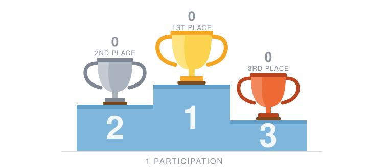
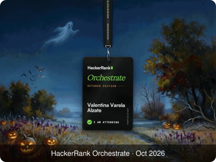

# Hackathons

A collection of every hackathon I take part in: the challenge, my solution, and how it went. Each project lives in its own folder with its full solution.

  

## 📸 Gallery

  

## 🎟️ Participations

| Date | Hackathon | Project | Stack | Result |
| --- | --- | --- | --- | --- |
| Oct 2026 | [HackerRank Orchestrate, October Edition](#hackerrank-orchestrate--october-2026) | [Ghost Data Still Exists, deletion-audit agent](hackerrank-orchestrate-october26) |    |  Results pending |
