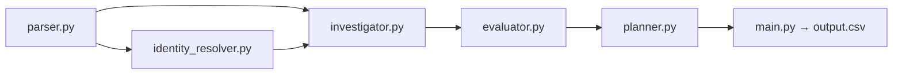

# tasks (SDD)

## Modular Architecture

Deterministic Python pipeline (`code/`), using an LLM only where the problem is ambiguous (multilingual intent, PDFs/images). Every LLM result is cached on disk so the full run is reproducible and token usage is measurable.

| Module | Responsibility | Input | Output |
|---|---|---|---|
| `models.py` | Contracts: `Case`, `Identity`, `EvidenceRecord`, `Resource`, `Step`, phase/operation/state enums and their canonical order | — | dataclasses |
| `parser.py` | Load CSVs; extract and normalize evidence (SQL→in-memory SQLite, JSON, logs, TXT, PDF, images) into `EvidenceRecord` | `dataset/` | `Dataset` (tables + evidence index with `captured_at`) |
| `identity_resolver.py` | Request email → `user_id`; rebuild current and historical identifiers as of `audit_at` | `Dataset`, `Case` | `Identity` (user_id, emails, phones, names, hashes) |
| `investigator.py` | Search evidence and `system_activity` (≤ `audit_at`) for everything linked to the identity; rebuild a per-resource timeline | `Identity`, `Dataset`, `audit_at` | `list[Resource]` (system_id, resource_id, category, observed state, latest evidence, active flows/backups) |
| `evaluator.py` | Classify intent (`NOT_APPLICABLE`); apply `deletion_rules.csv` to each resource; decide `COMPLETE`/`INCOMPLETE` | `Case`, `list[Resource]` | `Assessment` (status, violations, compliant resources) |
| `planner.py` | Build `steps_json`: FINDING → REMEDIATION → VERIFICATION, ordered by operation → system_id → resource_id; deterministic serialization | `Assessment` | `list[Step]` / JSON |
| `llm.py` | LLM client (key from environment variable), cache, token/cost counter | prompts | responses + usage metrics |
| `main.py` | Orchestrate all 518 cases and write `output.csv` at the repo root | `dataset/` | `output.csv` |
| `evaluation/main.py` | Evaluate against `sample_output.csv` + custom cases; generate reports | outputs | `evaluation_report.md`, `usage_report.md` |

Principles: only data from `dataset/`; nothing after `audit_at`; `reported_status`/`reported_result` are claims, not proof; no hardcoded labels.

---

## Tasks

### [X] TASK-01 — Contracts and domain models
- **Inputs:** `problem_statement.md` §Allowed Operations, `AGENTS.md` §6.
- **Outputs:** `code/models.py` (dataclasses + enums), canonical operation-order table, operation→state map, rule action → (finding, remediation, verification) map.
- **Dependencies:** none.
- **Acceptance criteria:** phase/operation/state combinations are exactly the allowed ones; invalid steps cannot be built.

### [X] TASK-02 — CSV loading and time utilities
- **Inputs:** the 8 CSVs in `dataset/`.
- **Outputs:** `parser.py::load_tables()`; ISO-8601 UTC parsing; `at_or_before(audit_at)` filter.
- **Dependencies:** TASK-01.
- **Acceptance criteria:** 518 cases, 32 samples, 94 manifest evidence files, 4011 activities, 306 audit events loaded without loss.

### [X] TASK-03 — Structured evidence extractors
- **Inputs:** `evidence/databases/*.sql`, `evidence/records/*.json|txt`, `evidence/logs/*.log`, `evidence_files.csv`.
- **Outputs:** `parser.py::extract_structured()` → `EvidenceRecord(file_id, captured_at, system_id, resource_id, fields, raw_text)`; SQL executed in per-file in-memory SQLite (primary vs replica comparison).
- **Dependencies:** TASK-02.
- **Acceptance criteria:** every non-multimodal manifest file yields records indexable by email/phone/hash/user_id/resource_id.

### [X] TASK-04 — Multimodal extraction (PDFs and images) with cache
- **Inputs:** `evidence/documents/*`, `evidence/images/*`.
- **Outputs:** `llm.py` (client + cache + token counter); `parser.py::extract_multimodal()` → `EvidenceRecord` with structured fields (resource_id, user_id, email, visible state, flows/selectors, backups).
- **Dependencies:** TASK-03.
- **Acceptance criteria:** PDF text via local extractor when possible; LLM vision only for images; second run = 0 calls (cached).

### [X] TASK-05 — Request intent classification
- **Inputs:** `request_text` (multilingual).
- **Outputs:** `evaluator.py::authorizes_deletion(case) -> bool` using a cheap LLM + cache, with a rule/keyword fallback.
- **Dependencies:** TASK-04 (`llm.py`).
- **Acceptance criteria:** access, correction, export, marketing opt-out → `NOT_APPLICABLE`; 100% agreement with samples.

### [X] TASK-06 — Identity resolution
- **Inputs:** `user_identities.csv`, `user_audit_log.csv`, case email, `audit_at`.
- **Outputs:** `identity_resolver.py::resolve(case) -> Identity` (user_id + all current/historical email, phone, name, email_hash values with audit IDs).
- **Dependencies:** TASK-02.
- **Acceptance criteria:** historical emails resolve to the correct user; no collisions with decoys.

### [X] TASK-07 — Investigation and state reconstruction
- **Inputs:** `Identity`, evidence index, `system_activity.csv`, `audit_at`.
- **Outputs:** `investigator.py::investigate(identity, audit_at, *, reported_at=None, tables=None, index=None) -> list[Resource]` with data category, true state at `audit_at` (present/absent/redacted/anonymized), proving evidence (`file_id`/`activity_id`/`audit_id`), active sync/import flows and restore paths. Items are `InvestigatedResource` (a `Resource` subclass adding `evidence_ids`, `observed_at`, `recreated`, `notes`). Callers must pass `case.reported_at`: it anchors the account lookup (single account `DELETE_RECORD` within -90/+20 min of `reported_at`).
- **Dependencies:** TASK-03, TASK-04, TASK-06.
- **Acceptance criteria:** evidence after `audit_at` is ignored; a `SUCCESS` without state evidence is not accepted; recreation after deletion (sync/restore) is detected.
- **Known limits (verified on samples):** accounts and anonymized analytics profiles carry no identifier and are linked only by activity-stream heuristics (`reported_at` window; second-of-minute offset 40-42 s after the account delete), so some are not found (e.g. case_04). Some golden ids (e.g. security audit records) appear in no visible source. A decoy log can add an extra resource (case_17, `account_6523`). The golden choice of cited evidence file is unknown; the latest valid observation at or before `audit_at` is used.

### [] TASK-08 — Policy application and status decision
- **Inputs:** `list[Resource]`, `deletion_rules.csv`, TASK-05 result.
- **Outputs:** `evaluator.py::assess() -> Assessment` (status + violations + compliant verifications); handling of `ACCOUNT_TOMBSTONE`, `RETAIN`, legal hold, backups. Calls `investigate(..., reported_at=case.reported_at)`. Resources with a `risk_kind` are judged with `RISK_COMPLIANT_STATE` (flow must be `DISABLED`, restore `BLOCKED`); all others with `RULE_ACTION_COMPLIANT_STATE` for their `data_category`.
- **Dependencies:** TASK-05, TASK-07.
- **Acceptance criteria:** `COMPLETE` only if every resource complies, every retained record is still present, and no flows/restores are active. On the 32 samples, violation vs compliant status per shared resource and the case status agree with `sample_output.csv`.

### [] TASK-09 — Step planner and orchestration
- **Inputs:** `Assessment`.
- **Outputs:** `planner.py::build_steps()` (findings with evidence; remediation: disable flows and block restores first, downstream copies before the source; verification for every remediated resource with `evidence_id=""`); `main.py` writes `output.csv` (518 rows, sorted, deterministic JSON).
- **Dependencies:** TASK-08.
- **Acceptance criteria:** consecutive `step_no` starting at 1; order phase → operation → system_id → resource_id; schema validation before writing.
- **Fallback for unlinked fixed steps:** the account (`VERIFY_RECORD_ABSENT`) and the subject's security audit record (`VERIFY_RECORD_PRESENT`) are expected in every deletion case. When the investigator cannot find them from visible data, the planner must still emit the steps from whatever ids were found, and skip them (never invent ids) when none exist. Cite only evidence captured at or before `audit_at`.

### [] TASK-10 — Evaluation, reports and documentation
- **Inputs:** `sample_deletion_requests.csv`, `sample_output.csv`, `llm.py` metrics.
- **Outputs:** `code/evaluation/main.py`; `code/evaluation/evaluation_report.md` (status, step, field and sequence accuracy; ≥3 custom cases; failures and improvements); `code/evaluation/usage_report.md` (provider/model, calls, input/output tokens, totals/average, cost); `README.md` with setup and run instructions.
- **Dependencies:** TASK-09.
- **Acceptance criteria:** a clean `python3 code/main.py` run produces 518 valid rows; reports complete and free of secrets.
- **Failures to document in `evaluation_report.md`:** partial account coverage via the `reported_at` window; anonymized analytics linked by a second-of-minute heuristic; ids absent from any visible source; the case_17 decoy (`account_6523`); unknown golden choice of cited evidence file (latest valid observation used); intent classification of 31 texts relying on the rule fallback until the LLM quota resets.

## Execution Order

TASK-01 → TASK-02 → (TASK-03, TASK-06) → TASK-04 → TASK-05 → TASK-07 → TASK-08 → TASK-09 → TASK-10
